<p align="center">
  
</p>

<div align="center">

[](https://alessandroparavano.github.io/crossillion/)


[](https://github.com/AlessandroParavano/crossillion/commits/main)

<a href="https://alessandroparavano.github.io/crossillion/"></a>

</div>

<p align="center"></p>

##  The game

Seven questions. A 3-second preview, then 25 seconds each. **Name something from the faith: the rarer your answer, the deeper you sink.** A common answer barely moves you. A rare one drops you hundreds of meters, through the street outside a church, the nave, the crypt and the catacombs, towards the Holy of Holies. Seven perfect answers reach 7,000 meters.

<p align="center">
  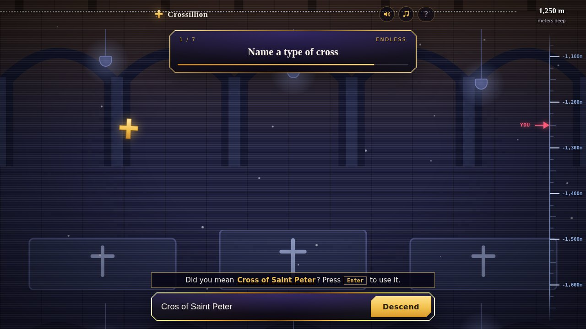
  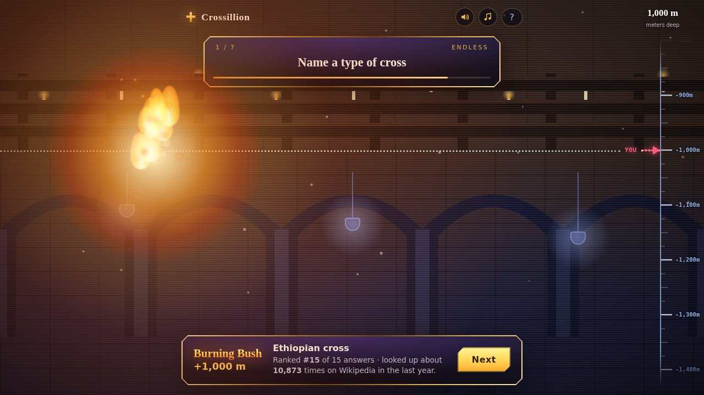
</p>

<p align="center">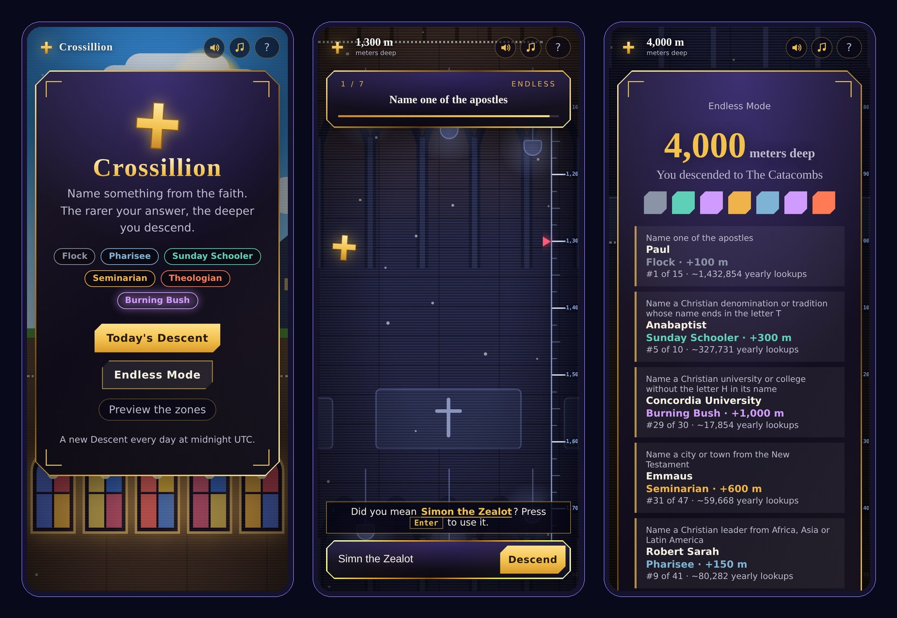</p>

<p align="center"></p>

##  The idea

Most trivia rewards the answer everyone already knows. Crossillion rewards the one almost nobody thinks of, so a good game is about how widely you know the faith, not just how well.

<table width="100%">
  <tr>
    <td width="33%" valign="top">
      <h3 align="center"> Rare beats obvious</h3>
      <p align="center">Every answer is scored by how rarely people look it up. Naming <i>Matthias</i> beats naming <i>Peter</i>, and the game can prove it.</p>
    </td>
    <td width="33%" valign="top">
      <h3 align="center"> A world to sink through</h3>
      <p align="center">A live cross-section scrolls past as you descend. Five zones, each more sacred than the last, with a depth ruler and your own marker on it.</p>
    </td>
    <td width="33%" valign="top">
      <h3 align="center"> Forgiving and fair</h3>
      <p align="center">Misspell something and you get a "Did you mean...?". Rule questions tell you when a real answer breaks the rule, instead of just saying no.</p>
    </td>
  </tr>
</table>

<p align="center"></p>

##  Where the rarity comes from

Google search volume has no public API, so Crossillion uses the **Wikimedia Pageviews API** (public, free, no key). Every answer is an English Wikipedia article, and its score is the number of **human (non-bot) pageviews over the last 12 full months**. Inside each question the answers are ranked by that number and cut into six tiers.

<p align="center"></p>

<p align="center"></p>

**Limits worth knowing.** Tiers are relative to the answers *we list* for a question (a static site cannot collect what other players typed). Pageviews measure public curiosity, so recent news inflates a page. And an answer that is not in the list shows "Not in our records".

<p align="center"></p>

##  The descent

<p align="center">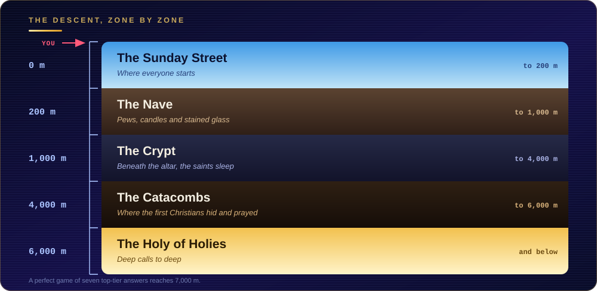</p>

<table>
  <tr>
    <td>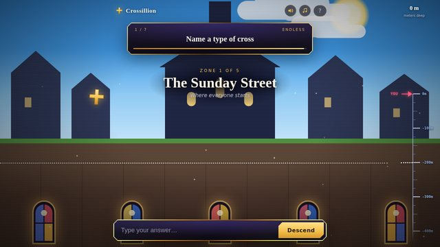</td>
    <td>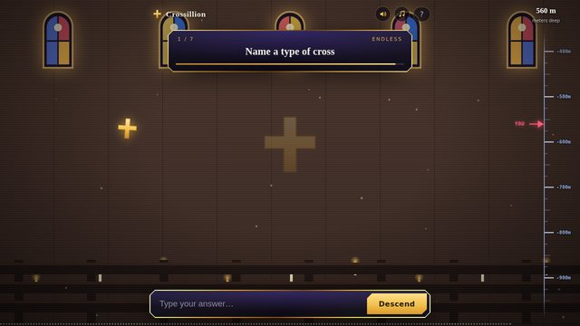</td>
    <td>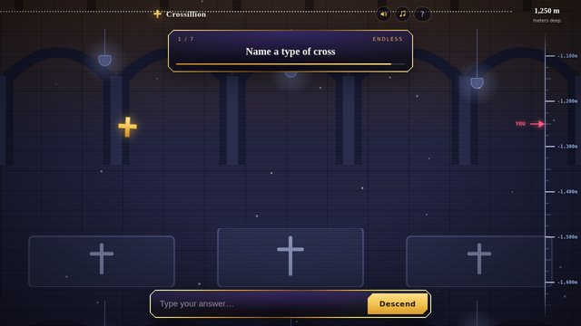</td>
    <td>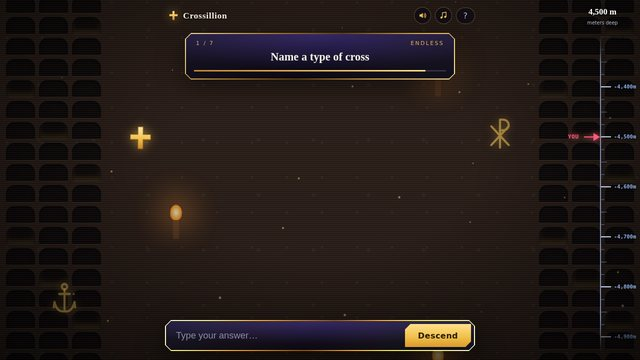</td>
    <td>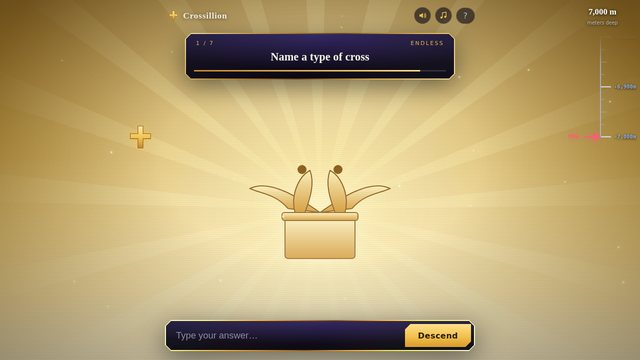</td>
  </tr>
  <tr align="center">
    <td><sub>The Sunday Street</sub></td>
    <td><sub>The Nave</sub></td>
    <td><sub>The Crypt</sub></td>
    <td><sub>The Catacombs</sub></td>
    <td><sub>The Holy of Holies</sub></td>
  </tr>
</table>

<p align="center"></p>

##  What is in it

**235 questions and over 4,200 answers.** Plain categories (popes, parables, hymns, church architecture, Bible places, composers, films...) plus questions with a rule, the way Krillion does it:

| Kind | Example | How it is made |
| :-- | :-- | :-- |
| Plain category | *Name a parable of Jesus* | Written by hand in `content/` |
| Letter rule | *Name a book of the Bible whose name starts with J* | Generated from the answers already there |
| Length or vowel rule | *Name a woman from the Bible with a six-letter name* | Generated |
| Fact filter | *Name a pope from before the year 1000* | A short hand-written list in `content/facts.txt` |

Rule questions are ranked only among the answers that fit them, so rarity is measured inside the smaller group.

<details>
<summary><strong>Take the feature tour</strong></summary>
<br>

###  Answer matching

Capital letters, accents, punctuation and leading words like *the*, *saint* or *pope* are forgiven. A near miss gets a *"Did you mean...?"* that Enter accepts. A real answer that breaks a question's rule is told so ("That's a real answer, but it doesn't fit this question's rule").

###  Sound and music, with no audio files

Every sound effect and every note of the music is **synthesised live in the browser** with the Web Audio API, so there is nothing to download or license. Each zone has its own looping theme (a bouncy street tune, a slow organ in the nave, a cold drone in the crypt, a heartbeat and dripping water in the catacombs, a shimmering choir at the bottom) and the music crossfades as you sink. Rewards play a jingle that gets longer and brighter with the tier. Two buttons switch effects and music on and off, and `dev/sound-lab.html` lets you hear and tune every sound.

###  The Burning Bush

Land the top tier and the cross catches fire: it flares white-hot, flames and embers rise around it, and a crackling roar plays, but the cross is not consumed.

###  The cross and the verse of the day

Touch the cross on the home screen for a holy glow and a random ESV verse. Everyone gets the same verse each day, and *Another verse* draws a fresh one. The pool is 450 verses picked at random from the whole Bible.

<p align="center">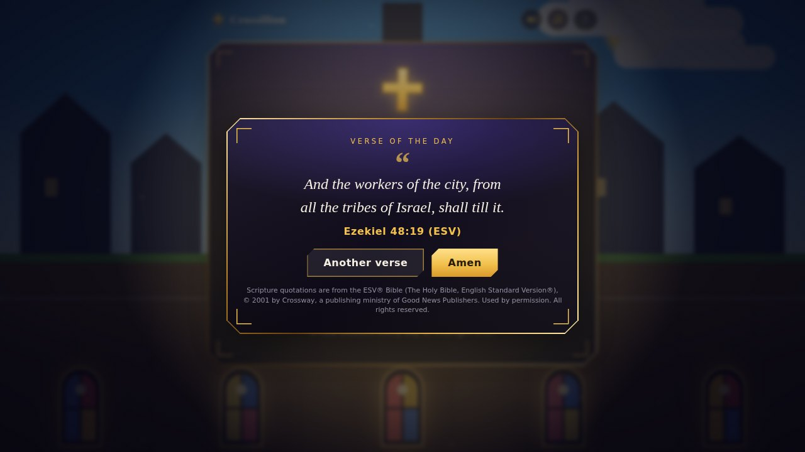</p>

###  A result you can share

At the end you get a card with your depth, the zone you reached and one coloured square per question, drawn on a canvas and shared, copied or saved as an image.

<p align="center">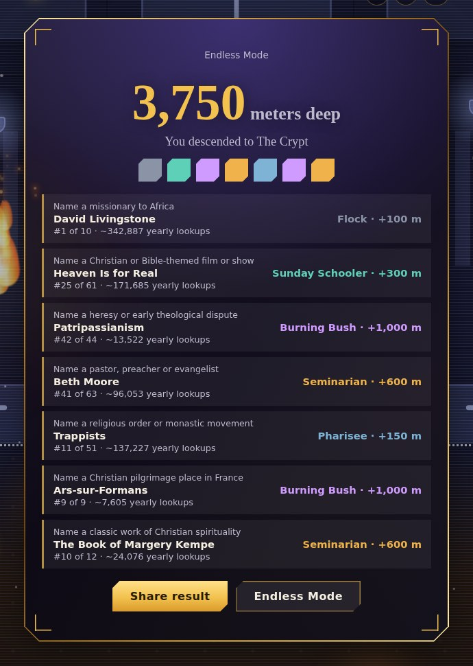</p>

###  One game a day, for everyone

The daily questions come from the UTC date, so everyone plays the same Descent. They walk through a shuffled order of the whole bank, so a question does not come back until every other question has had its turn. Progress and stats live in the browser's `localStorage` only.

</details>

<p align="center"></p>

##  Tech stack

| Part | Technology | What it does |
| :-- | :-- | :-- |
| **Game** |    | Plain files and no framework. Small scripts that each do one job and share one object. |
| **Sound** |  | Synthesised effects and chiptune music, built on the fly. |
| **Data tools** |  | One command turns the text files in `content/` into the game's data. Standard library only. |
| **Rarity data** |  | Twelve months of real human pageview counts. |
| **Verses** |  | Random verses from the whole Bible, downloaded from esv.org. |
| **Hosting** |  | A static site: no server, no build step. |

<p align="center"></p>

##  Run it, change it

It is a plain static site. Serve the folder with any web server and open it:

```bash
python3 -m http.server        # then visit http://localhost:8000
```

To publish it, use **Settings > Pages > Deploy from branch > `main` / root** on GitHub.

### How the project is organised

```
index.html            the page (no questions or settings inside it)
css/                  styles, one file per job: base, world, ui, ruler, effects, responsive
js/                   code, one small file per job
  config.js             * settings: rounds, timer, rarity tiers, zones, music mapping
  audio/                sound effects and music, all synthesised
content/              * the questions and answers you write     (see content/README.md)
tools/                the build: `python3 tools/build.py` turns content/ into data/
data/                 generated files, never edited by hand (answers.js, verses.js)
dev/                  sound-lab.html, and the script that draws the artwork in this README
```

The files in `js/` each add themselves to one shared object called `CX` and are loaded in order by `index.html` (plain scripts, so the site also works when opened straight from a folder).

| File | Job |
| :-- | :-- |
| `config.js` | all tweakable settings |
| `util.js` | helpers: saved data, seeded random numbers, a tiny event bus |
| `rules.js` | which tier an answer is, which zone a depth is in |
| `matching.js` | forgiving answer matching and "did you mean...?" typo help |
| `rotation.js` | which questions a game uses (the daily cycle, and endless mode) |
| `world.js` | the five scenes, the camera and the depth ruler |
| `audio/engine.js` `sfx.js` `music.js` | the sound system, the effects, the music |
| `effects.js` | the holy glow and the Burning Bush fire |
| `verses.js` | the verse card |
| `share.js` | the shareable result picture |
| `game.js` | one game: the clock, answering, scoring |
| `screens.js` | home, game and results screens and the zone tour |
| `main.js` | starts everything and connects the buttons |

### How do I...

| ...do this | Edit |
| :-- | :-- |
| add a question or more answers | a file in `content/`, then `python3 tools/build.py` |
| add a "female saints"-style filter question | `content/facts.txt` |
| rename a tier, change its meters or colour | `tiers` in `js/config.js` (no rebuild needed) |
| change the timer or the number of questions | `js/config.js` |
| move a zone's depth or rename a zone | `zones` in `js/config.js` |
| add a new zone | a zone entry in `js/config.js`, a drawing in `js/world.js`, a theme in `js/audio/music.js` |
| change a sound or the music | `js/audio/sfx.js` or `js/audio/music.js`, then listen in `dev/sound-lab.html` |
| draw a fresh pool of verses | `python3 tools/build.py --verses` |

### Commands

| Command | What it does |
| :-- | :-- |
| `python3 tools/build.py` | builds `data/answers.js` (downloads only what is new, then caches it) |
| `python3 tools/build.py --check` | checks the files in `content/` for mistakes, with no network |
| `python3 tools/build.py --offline` | rebuilds using only what is already cached |
| `python3 tools/build.py --verses` | draws a fresh random pool of ESV verses |
| `python3 dev/make-readme-art.py` | redraws the diagrams in this README from `js/config.js` |

<p align="center"></p>

##  Credits and licensing

- **Scripture** quotations are from the ESV&reg; Bible (The Holy Bible, English Standard Version&reg;), &copy; 2001 by Crossway, a publishing ministry of Good News Publishers. Used by permission. All rights reserved. The verse pool is capped at 450 verses, inside the ESV's free-quotation allowance, and **the copyright notice shown on the verse card must stay there.**
- **Rarity data** comes from the Wikimedia Foundation's public pageview statistics.
- The format, the six-tier ladder, the zone depths and the timings follow the game **Krillion**, which inspired this one.

<p align="center">
  <sub>Built by</sub><br>
  <b>Alessandro Paravano</b>
</p>
